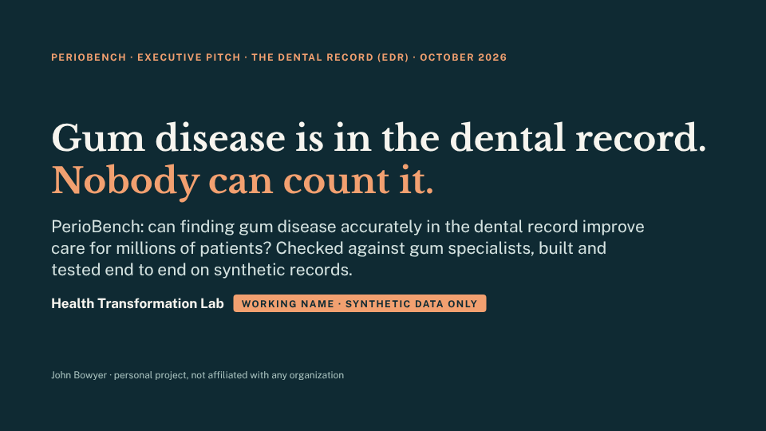
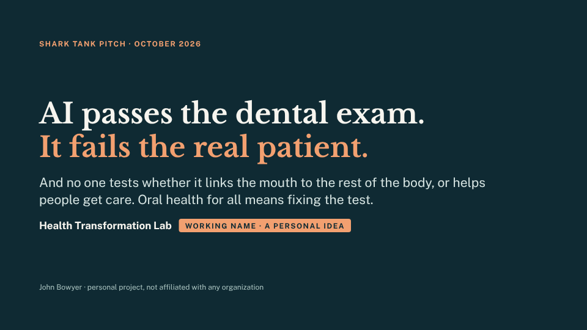

# Health Transformation Lab

> **Personal learning project.** Built on my own time: not affiliated with or endorsed by any employer,
> institution or vendor, and nothing here is any organization's plan, study or finding. Synthetic data only. See
> [DISCLAIMER.md](DISCLAIMER.md).

**The goal: better health answers from AI, and better care for the millions of people who ask.** More than 40
million people a day ask OpenAI's assistant alone about their health (OpenAI, January 2026), and those answers shape
the care they seek and get. AI developers such as OpenAI, Anthropic and Google improve what public benchmarks measure,
and no public benchmark we found checks answers where medicine meets dentistry, or whether an answer helps someone get
care. The lab builds those benchmarks in the open: [healthtransformationlab.org](https://healthtransformationlab.org).

Two benchmarks so far, each with a short pitch that drills down to the detail.

## 1. PerioBench: better care for gum disease through more accurate diagnosis

<a href="docs/edr/full_text_and_notes.md"></a>

The goal is better care for people with periodontitis. Gum disease is written down at almost every dental visit,
but in pieces: notes, forms, codes and measurements that often disagree, so it is missed, can't be followed over
time, and can't be linked to diabetes care. A diagnostic tool that reads the whole record accurately lets clinics
find it earlier and treat it. PerioBench scores how accurately rules and AI diagnose it; agreement with gum
specialists is how accuracy is checked, not the goal. It runs end to end on **synthetic** records:

- the whole record, combined by rules that read the gum measurements first: **234 of 240** charts right;
- the free-text note alone, read by a small trained model with a stage 4 rule: **219 of 240**;
- a bigger medical AI used as is, with the same rule: **185 of 240**.

Scored against the generator's truth on synthetic charts, not clinical performance. Read in a different order,
the same evidence gets 173: the order is one of the findings.

| For | Go to |
|---|---|
| **Executives** (11 slides, 10 minutes) | [read the pitch with speaker notes](docs/edr/full_text_and_notes.md) · [slides](docs/edr/deck.html) (download and open in a browser) |
| **Scientists** | [the study](docs/edr/README.md): the seven kinds of evidence, every method with 95% intervals, the acceptance test, models, de-identification |
| **Engineers** | [code walkthrough](docs/code_walkthrough.md), [deployment](docs/deployment.md), [how we work](AGENTS.md) |

## 2. OralHealthBench: correct answers where medicine meets dentistry

<a href="docs/pitch/full_text_and_notes.md"></a>

Twelve leading AI models average 81% on the dental licensing exam but 22% on real patient cases (GlobalDentBench,
2026). No public test we found checks whether they connect the mouth to the rest of the body: a medicine that makes a tooth
extraction unsafe, or gum disease and diabetes. OralHealthBench puts those questions, each traced to published
evidence, with public results so improvements are visible, and measures how much an open evidence agent improves
their answers. Its companion, **AccessBench**, asks whether an answer works for someone with no coverage, no car or
no dentist nearby.

| For | Go to |
|---|---|
| **Executives** (6 slides, plus backup) | [read the pitch with speaker notes](docs/pitch/full_text_and_notes.md) · [slides](docs/pitch/deck.html) (download and open in a browser) |
| **Detail** | [the pitch's sources and how this repo tests it](docs/pitch/README.md) |

## How the two paths connect

The dental record path builds synthetic patients whose right answers are known, in OMOP, the format medicine
already uses. Those patients become test questions for the lab. One harness, with the same models, runners, harm grades
and leaderboards, scores AI first on gum charts, then on case questions, then on broader medical-dental questions.

## Run it

```bash
cd python && pip install -e ".[dev]"
pytest -q tests                                    # Python tests
cd .. && python/scripts/make_parity_inputs.sh && Rscript r/tests/test_parity.R   # Python and R give the same numbers
python docs/build_decks.py                         # rebuild both decks from docs/<deck>/slides/
```

Ground rules: synthetic data only, never PHI; Python and R in parity; anything simulated is labelled simulated
([AGENTS.md](AGENTS.md)). Open decisions: [action items](docs/action_items.md). Owner John Bowyer · MIT licence.
