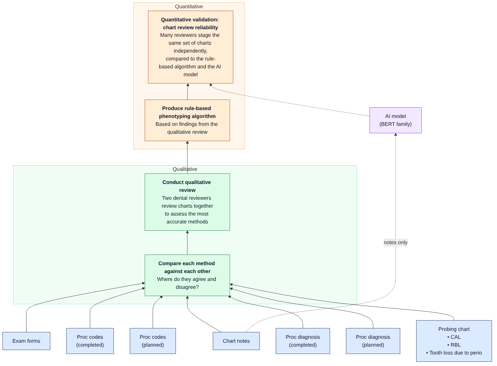

# dental-omop-nlp

How well can periodontal status be phenotyped from a dental EHR, and can a
BERT-family model reading the chart notes match clinicians? This repo runs that
study end to end on **synthetic** data so the pipeline, the reviewer workflow
and the analysis are ready before real data is approved.



Seven sources per visit → compare methods → qualitative review → rule-based
phenotyping algorithm → several reviewers stage the same charts in Label Studio,
compared against the algorithm and the AI model. Details:
[docs/process.md](docs/process.md).

**Ground rules**

- **Synthetic data only.** Every patient, note and code here is generated. No PHI,
  no real records, no employer or partner data, ever. Pull requests that add
  real data are closed on sight.
- **Nothing identifiable reaches Label Studio or a model.** Synthetic notes carry
  fake PHI on purpose; the de-identification step must remove all of it, and a
  leak gate blocks any note where it didn't.
- **Public until approved for internal use.** Then the code moves to the internal
  workspace and this repo stays the public reference.
- **Two languages, one contract.** Data engineering works in Python, data
  science in R. Both read the same files and produce the same numbers
  (parity-tested to 1e-16).

## Datasets (in `data/datasets/`, regenerate with `scripts/10_build_study.py`)

| File | What it is |
|------|------------|
| `train.csv` | ~2,400 de-identified notes from ~970 people, labeled by the generator (chart truth and the clinician's written dx). For training the AI model. |
| `review_tasks.json` | 240 charts (one visit per person, rare statuses oversampled), every source, de-identified. **Import into Label Studio.** |
| `answer_key/review_key.csv` | Generator truth and each method's reading for the 240 charts. **Reviewers must not see this.** |
| `method_agreement.csv`, `method_coverage.csv` | Pairwise agreement and kappa between the seven sources. Input to the qualitative review. |
| `deid_report.csv` | Per-note de-identification recall and over-redaction against the injected fake PHI. |

## What's in here

| Path | What it is |
|------|------------|
| `python/dental_omop_nlp/` | `study.py` builds everything; `clinical_notes.py`, `sources.py`, `phi.py` generate; `deid.py` de-identifies; `note_reader.py` + `sources.READERS` read each source; `phenotype.py` compares methods and holds the rule-based algorithm; `rungs.py` the AI models; `labelstudio.py`, `reliability.py` the validation |
| `labelstudio/` | Labeling config and setup steps |
| `r/` | R twin: labels, scorer, reliability (`04_reliability.R`), tidymodels/`text` models, OHDSI ETL-Synthea. Local run and GPU guidance in `r/README.md` |
| `models.yaml` | 12 candidate encoders from the evaluation sheet, with roles and ladders |
| `omop/` | OMOP CDM 5.4 dental extension (`SITE`, `SITE_EVENT`) from the OHDSI Dentistry Workgroup |
| `databricks/` | Free Edition notebook |
| `docs/` | [process](docs/process.md), [labeling protocol](docs/labeling_protocol.md), [plan and timeline](docs/plan.md), [design review for Databricks](docs/design_review_rsa.md), [ADRs](docs/adr/) |

## Quick start

```bash
cd python && pip install -e .

python scripts/10_build_study.py                 # datasets above
python scripts/11_ai_predict.py --rung note_rules
python scripts/11_ai_predict.py --rung tfidf_logreg
# python scripts/11_ai_predict.py --rung distilbert-base --epochs 2   # pip install -e ".[models]"

# Reviewers stage review_tasks.json in Label Studio (labelstudio/README.md), then:
python scripts/12_import_review.py reviewer1.json reviewer2.json reviewer3.json
python scripts/13_reliability.py                 # or: Rscript r/R/04_reliability.R

# Dry run with simulated reviewers (files and output marked SIMULATED):
python scripts/12_import_review.py --simulate 4 && python scripts/13_reliability.py --simulated

pytest -q tests && cd .. && Rscript r/tests/test_parity.R
```

The earlier short-note benchmark (`scripts/01`–`03`) is still here for quick
model comparisons; see `python/README.md`.

## Background

- Chuang, Lee, Tokede, Lin, Brandon, Tran, Jiang, Walji. *Artificial Intelligence
  in Extracting Diagnostic Data from Dental Records* (UTHealth + UCSF):
  RoBERTa trained on GPT-4 synthetic notes, tested on 240 dentist-labeled notes
  per site; status, stage, grade, extent. [arXiv 2407.21050](https://arxiv.org/abs/2407.21050)
- Patel J.S. *Utilizing Electronic Dental Record Data to Track Periodontal
  Disease Change*, PhD dissertation, IUPUI 2020: charting-derived and
  clinician-recorded diagnoses agreed 47% of the time; charting present for
  ~80% of patients. [IU ScholarWorks](https://scholarworks.indianapolis.iu.edu/items/0768bd4f-e24a-465a-95fe-b8cabca06c68/full)
- Patel J.S. et al. *Developing Automated Computer Algorithms to Phenotype
  Periodontal Disease Diagnoses in Electronic Dental Records*, Methods of
  Information in Medicine 2022.
- OHDSI Dentistry Workgroup, *Mapping Dental Use Cases to the OMOP-CDM*
  (SITE / SITE_EVENT proposal). [OHDSI 2023](https://ohdsi.org/wp-content/uploads/2023/10/39-Koski-OHDSIreport-Robert-Koski.pdf)

## Owners

- Python / data engineering / OMOP: John Bowyer
- R / data science: _TBD_

## License

MIT. OMOP CDM and the OHDSI tools are Apache-2.0. Model licenses are listed per
model in `models.yaml`; check them before redistributing fine-tuned weights.
