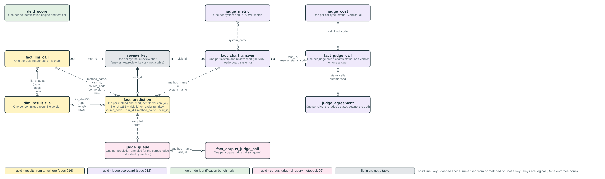
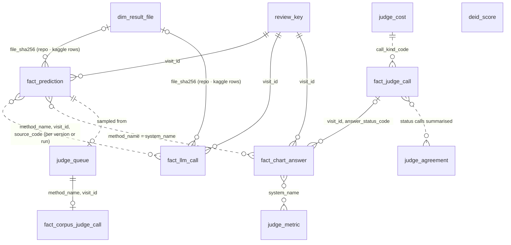
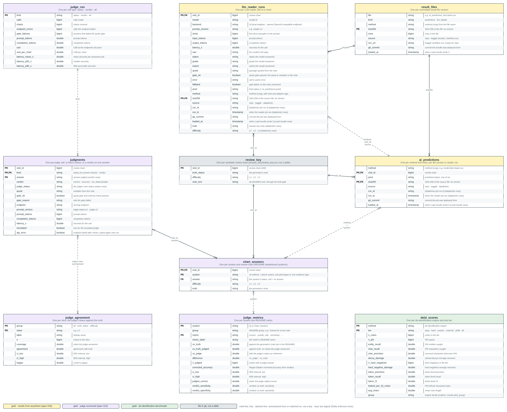

# Gold data model: `health_transformation_lab.gold_dental_omop_perio`

Generated from [`_build/gold_model.py`](../_build/gold_model.py) by `_build/gold_erd.py`; `python/tests/test_gold_model.py` checks the columns against the CSV twins and `results_store`. Names follow AGENTS.md, SQL and data names (spec 018). Keys are logical: Delta enforces none. Solid lines are keys; dashed lines are summaries or matches, not keys. PNGs are in this folder; the draw.io and Mermaid sources are in `source/`. Who writes each table and why: [docs/gold_tables.md](../../docs/gold_tables.md). Synthetic data only.

## Tables and relationships (entity)

## Every column (full)

```mermaid
erDiagram
    dim_result_file |o--o{ fact_prediction : "file_sha256 (repo · kaggle rows)"
    dim_result_file |o--o{ fact_llm_call : "file_sha256 (repo · kaggle rows)"
    fact_prediction }o..o{ fact_llm_call : "method_name, visit_id, source_code (per version or run)"
    review_key ||--o{ fact_prediction : "visit_id"
    review_key ||--o{ fact_llm_call : "visit_id"
    review_key ||--o{ fact_chart_answer : "visit_id"
    fact_judge_call |o--o{ fact_chart_answer : "visit_id, answer_status_code"
    judge_cost ||..o{ fact_judge_call : "call_kind_code"
    fact_judge_call }o..o{ judge_agreement : "status calls summarised"
    fact_chart_answer }o..o{ judge_metric : "system_name"
    fact_prediction }o..o{ fact_chart_answer : "method_name = system_name"
    fact_prediction ||..o| judge_queue : "sampled from"
    judge_queue ||--o| fact_corpus_judge_call : "method_name, visit_id"
    review_key {
        bigint visit_id PK "review chart (240)"
        string truth_status "the generator's truth"
        string difficulty "L1 · L2 · L3"
        string note_text "de-identified note, through the leak gate"
    }
    dim_result_file {
        string file_name "e.g. ai_predictions_bert-base.csv"
        string file_kind_code "predictions · llm_details"
        string method_name "method (rung) from the file name"
        string file_sha256 PK "SHA-256 of the file: its version"
        bigint row_count "rows in the file"
        string source_code "repo · kaggle (results_manifest.csv)"
        string run_url "Kaggle workflow run; empty for repo"
        string git_commit_sha "commit the bundle was deployed from"
        timestamp loaded_ts "when Load results wrote it"
    }
    fact_prediction {
        string method_name "method (rung), e.g. modernbert-base+cw"
        bigint visit_id PK, FK "review chart"
        string predicted_status_code "predicted status, one of six"
        string file_sha256 PK, FK "SHA-256 of the source file: its version (in dim_result_file for repo · kaggle rows only)"
        string source_code "repo · kaggle · databricks"
        string run_id "Databricks job run id (databricks rows)"
        timestamp run_ts "when the reader job ran (databricks rows); fact_llm_call: also the load time of Load results rows"
        string git_commit_sha "commit the job was deployed from"
        timestamp loaded_ts "when Load results wrote it (Load results rows)"
    }
    fact_llm_call {
        bigint visit_id PK, FK "review chart"
        string model_name "model id"
        string backend_code "hf (local weights) · openai (OpenAI-compatible endpoint)"
        string prompt_version_code "e.g. reader-v2"
        bigint shot_count "few-shot examples in the prompt"
        bigint input_token_count "prompt tokens"
        bigint output_token_count "completion tokens"
        double latency_seconds "seconds for the call"
        string raw_response_text "the model's full reply"
        string answered_status_code "status the model answered"
        string answered_grade_code "grade the model answered"
        string answered_extent_code "extent the model answered"
        string quote_text "passage quoted from the note"
        boolean is_gate_ok "quote gate passed: the quote is verbatim in the note"
        string error_text "call or parse error"
        boolean is_fallback "gate failed, so the rules answered"
        string predicted_status_code "final status (= fact_prediction.predicted_status_code)"
        string method_name "method (rung), with shot and adapter tags"
        string file_sha256 PK, FK "SHA-256 of the source file: its version (in dim_result_file for repo · kaggle rows only)"
        string source_code "repo · kaggle · databricks"
        string run_id "Databricks job run id (databricks rows)"
        timestamp run_ts "when the reader job ran (databricks rows); fact_llm_call: also the load time of Load results rows"
        string git_commit_sha "commit the job was deployed from"
        timestamp loaded_ts "when Load results wrote it (Load results rows)"
        string truth_status_code "answer key truth (databricks rows)"
        string difficulty_code "L1 · L2 · L3 (databricks rows)"
    }
    fact_chart_answer {
        bigint visit_id PK, FK "review chart"
        string system_name PK "AI method, +rules4 variant, rule phenotype or one evidence type"
        string answer_status_code FK "the system's status; null = no answer"
        string difficulty_code "L1 · L2 · L3"
        string truth_status_code "the generator's truth"
    }
    fact_judge_call {
        bigint visit_id PK "review chart"
        string call_kind_code PK, FK "status (no answer shown) · verdict"
        string answer_status_code PK "answer judged (verdict rows)"
        string verdict_code "correct · incorrect · not_determinable"
        string judge_status_code "the judge's own status (status rows)"
        string quote_text "verbatim from the note"
        boolean is_gate_ok "quote gate and schema check passed"
        string gate_reason_text "why the gate failed"
        string endpoint_name "serving endpoint"
        string prompt_version_code "judge-status-v1 · judge-v2"
        bigint prompt_token_count "prompt tokens"
        bigint completion_token_count "completion tokens"
        double latency_seconds "seconds for the call"
        boolean is_simulated "true for the simulated judge"
        boolean is_api_error "endpoint failed after retries; asked again next run"
    }
    judge_metric {
        string system_name PK "as in fact_chart_answer"
        string group_name "README group, e.g. Trained AI on the note"
        string metric_code PK "correct · unsafe_rate · sensitivity · …"
        string metric_name "the metric's README name"
        double vs_truth_ratio "against the generator's truth (as in the README)"
        double vs_truth_judged_ratio "against truth, on charts the judge answered"
        double vs_judge_ratio "with the judge's status as reference"
        double difference_ratio "vs_judge − vs_truth"
        bigint judged_count "charts with a judge answer"
        double corrected_accuracy_ratio "Rogan-Gladen corrected accuracy from verdicts"
        double ci_low_ratio "95% interval, low"
        double ci_high_ratio "95% interval, high"
        double judged_correct_ratio "share the judge called correct"
        double verdict_sensitivity_ratio "verdicts vs truth: sensitivity"
        double verdict_specificity_ratio "verdicts vs truth: specificity"
    }
    judge_agreement {
        string slice_group_code PK "all · truth_status · difficulty"
        string slice_value_code PK "e.g. L3"
        string slice_name "display name"
        bigint chart_count "charts in the slice"
        double coverage_ratio "share the judge answered"
        double agreement_ratio "agreement with truth"
        double ci_low_ratio "95% interval, low"
        double ci_high_ratio "95% interval, high"
        double kappa_coef "Cohen's kappa"
    }
    judge_cost {
        string call_kind_code PK "status · verdict · all"
        bigint call_count "calls made"
        bigint chart_count "charts covered"
        bigint endpoint_error_count "calls the endpoint failed"
        bigint gate_failure_count "answers that failed the quote gate"
        bigint prompt_token_count "prompt tokens"
        bigint completion_token_count "completion tokens"
        double cost_usd "US$ at the endpoint's list price"
        double cost_per_chart_usd "US$ per chart"
        double avg_latency_seconds "mean seconds per answered call"
        double p50_latency_seconds "median seconds"
        double p95_latency_seconds "95th percentile seconds"
    }
    deid_score {
        string engine_name PK "de-identification engine"
        string tier_code PK "easy · hard · unseen · external · jsl48 · all"
        bigint note_count "notes in the tier"
        bigint phi_count "PHI spans"
        double entity_recall_ratio "PHI entities caught"
        double char_recall_ratio "PHI characters caught"
        double char_precision_ratio "removed characters that were PHI"
        double decoy_damage_ratio "clinical decoys wrongly removed"
        bigint hard_negative_count "hard negatives in the tier"
        double hard_negative_damage_ratio "hard negatives wrongly removed"
        double token_precision_ratio "token-level precision"
        double token_recall_ratio "token-level recall"
        double token_f1_ratio "token-level F1"
        double leaked_phi_per_1k_note_rate "PHI left per thousand notes"
        double avg_note_char_count "mean note length"
        string group_name "engine family (readme_results.deid_group)"
    }
    judge_queue {
        string method_name PK, FK "method (rung)"
        bigint visit_id PK, FK "chart or note"
        string note_text "de-identified note, through the leak gate"
        string predicted_status_code "the method's status, to judge"
    }
    fact_corpus_judge_call {
        string method_name PK, FK "method (rung)"
        bigint visit_id PK, FK "chart or note"
        string predicted_status_code "the status judged"
        string verdict_code "correct · incorrect · not_determinable"
        string supported_status_code "the status the judge says the note supports"
        string quote_text "verbatim from the note"
        string rationale_text "the judge's reason"
        boolean is_gate_ok "quote gate and schema check passed"
        string error_text "ai_query error"
        string prompt_version_code "judge-v2"
        string judge_model_name "serving endpoint"
    }
```

### `review_key`

One per synthetic review chart (answer_key/review_key.csv, not a table). Written by: 10_build_study.py (seeded).

| Key | Column | Type | Description |
|---|---|---|---|
| PK | `visit_id` | bigint | review chart (240) |
|  | `truth_status` | string | the generator's truth |
|  | `difficulty` | string | L1 · L2 · L3 |
|  | `note_text` | string | de-identified note, through the leak gate |

### `dim_result_file`

One per committed result file version. Written by: Load results: delete-then-append by file_sha256, written last.

| Key | Column | Type | Description |
|---|---|---|---|
|  | `file_name` | string | e.g. ai_predictions_bert-base.csv |
|  | `file_kind_code` | string | predictions · llm_details |
|  | `method_name` | string | method (rung) from the file name |
| PK | `file_sha256` | string | SHA-256 of the file: its version |
|  | `row_count` | bigint | rows in the file |
|  | `source_code` | string | repo · kaggle (results_manifest.csv) |
|  | `run_url` | string | Kaggle workflow run; empty for repo |
|  | `git_commit_sha` | string | commit the bundle was deployed from |
|  | `loaded_ts` | timestamp | when Load results wrote it |

### `fact_prediction`

One per method and chart, per file version (key file_sha256 + visit_id) or reader run (key source_code + run_id + method_name + visit_id). Written by: Load results: delete-then-append by file_sha256 · MedGemma reader: replace (source_code, run_id, method_name).

| Key | Column | Type | Description |
|---|---|---|---|
|  | `method_name` | string | method (rung), e.g. modernbert-base+cw |
| PK,FK | `visit_id` | bigint | review chart |
|  | `predicted_status_code` | string | predicted status, one of six |
| PK,FK | `file_sha256` | string | SHA-256 of the source file: its version (in dim_result_file for repo · kaggle rows only) |
|  | `source_code` | string | repo · kaggle · databricks |
|  | `run_id` | string | Databricks job run id (databricks rows) |
|  | `run_ts` | timestamp | when the reader job ran (databricks rows); fact_llm_call: also the load time of Load results rows |
|  | `git_commit_sha` | string | commit the job was deployed from |
|  | `loaded_ts` | timestamp | when Load results wrote it (Load results rows) |

### `fact_llm_call`

One per LLM reader call on a chart. Written by: as fact_prediction.

| Key | Column | Type | Description |
|---|---|---|---|
| PK,FK | `visit_id` | bigint | review chart |
|  | `model_name` | string | model id |
|  | `backend_code` | string | hf (local weights) · openai (OpenAI-compatible endpoint) |
|  | `prompt_version_code` | string | e.g. reader-v2 |
|  | `shot_count` | bigint | few-shot examples in the prompt |
|  | `input_token_count` | bigint | prompt tokens |
|  | `output_token_count` | bigint | completion tokens |
|  | `latency_seconds` | double | seconds for the call |
|  | `raw_response_text` | string | the model's full reply |
|  | `answered_status_code` | string | status the model answered |
|  | `answered_grade_code` | string | grade the model answered |
|  | `answered_extent_code` | string | extent the model answered |
|  | `quote_text` | string | passage quoted from the note |
|  | `is_gate_ok` | boolean | quote gate passed: the quote is verbatim in the note |
|  | `error_text` | string | call or parse error |
|  | `is_fallback` | boolean | gate failed, so the rules answered |
|  | `predicted_status_code` | string | final status (= fact_prediction.predicted_status_code) |
|  | `method_name` | string | method (rung), with shot and adapter tags |
| PK,FK | `file_sha256` | string | SHA-256 of the source file: its version (in dim_result_file for repo · kaggle rows only) |
|  | `source_code` | string | repo · kaggle · databricks |
|  | `run_id` | string | Databricks job run id (databricks rows) |
|  | `run_ts` | timestamp | when the reader job ran (databricks rows); fact_llm_call: also the load time of Load results rows |
|  | `git_commit_sha` | string | commit the job was deployed from |
|  | `loaded_ts` | timestamp | when Load results wrote it (Load results rows) |
|  | `truth_status_code` | string | answer key truth (databricks rows) |
|  | `difficulty_code` | string | L1 · L2 · L3 (databricks rows) |

### `fact_chart_answer`

One per system and review chart (README leaderboard systems). Written by: Judge scorecard: overwrite.

| Key | Column | Type | Description |
|---|---|---|---|
| PK,FK | `visit_id` | bigint | review chart |
| PK | `system_name` | string | AI method, +rules4 variant, rule phenotype or one evidence type |
| FK | `answer_status_code` | string | the system's status; null = no answer |
|  | `difficulty_code` | string | L1 · L2 · L3 |
|  | `truth_status_code` | string | the generator's truth |

### `fact_judge_call`

One per judge call: a chart's status, or a verdict on one answer. Written by: Judge scorecard: overwrite, earlier calls kept and resumed.

| Key | Column | Type | Description |
|---|---|---|---|
| PK | `visit_id` | bigint | review chart |
| PK,FK | `call_kind_code` | string | status (no answer shown) · verdict |
| PK | `answer_status_code` | string | answer judged (verdict rows) |
|  | `verdict_code` | string | correct · incorrect · not_determinable |
|  | `judge_status_code` | string | the judge's own status (status rows) |
|  | `quote_text` | string | verbatim from the note |
|  | `is_gate_ok` | boolean | quote gate and schema check passed |
|  | `gate_reason_text` | string | why the gate failed |
|  | `endpoint_name` | string | serving endpoint |
|  | `prompt_version_code` | string | judge-status-v1 · judge-v2 |
|  | `prompt_token_count` | bigint | prompt tokens |
|  | `completion_token_count` | bigint | completion tokens |
|  | `latency_seconds` | double | seconds for the call |
|  | `is_simulated` | boolean | true for the simulated judge |
|  | `is_api_error` | boolean | endpoint failed after retries; asked again next run |

### `judge_metric`

One per system and README metric. Written by: Judge scorecard: overwrite.

| Key | Column | Type | Description |
|---|---|---|---|
| PK | `system_name` | string | as in fact_chart_answer |
|  | `group_name` | string | README group, e.g. Trained AI on the note |
| PK | `metric_code` | string | correct · unsafe_rate · sensitivity · … |
|  | `metric_name` | string | the metric's README name |
|  | `vs_truth_ratio` | double | against the generator's truth (as in the README) |
|  | `vs_truth_judged_ratio` | double | against truth, on charts the judge answered |
|  | `vs_judge_ratio` | double | with the judge's status as reference |
|  | `difference_ratio` | double | vs_judge − vs_truth |
|  | `judged_count` | bigint | charts with a judge answer |
|  | `corrected_accuracy_ratio` | double | Rogan-Gladen corrected accuracy from verdicts |
|  | `ci_low_ratio` | double | 95% interval, low |
|  | `ci_high_ratio` | double | 95% interval, high |
|  | `judged_correct_ratio` | double | share the judge called correct |
|  | `verdict_sensitivity_ratio` | double | verdicts vs truth: sensitivity |
|  | `verdict_specificity_ratio` | double | verdicts vs truth: specificity |

### `judge_agreement`

One per slice: the judge's status against the truth. Written by: Judge scorecard: overwrite.

| Key | Column | Type | Description |
|---|---|---|---|
| PK | `slice_group_code` | string | all · truth_status · difficulty |
| PK | `slice_value_code` | string | e.g. L3 |
|  | `slice_name` | string | display name |
|  | `chart_count` | bigint | charts in the slice |
|  | `coverage_ratio` | double | share the judge answered |
|  | `agreement_ratio` | double | agreement with truth |
|  | `ci_low_ratio` | double | 95% interval, low |
|  | `ci_high_ratio` | double | 95% interval, high |
|  | `kappa_coef` | double | Cohen's kappa |

### `judge_cost`

One per call type: status · verdict · all. Written by: Judge scorecard: overwrite.

| Key | Column | Type | Description |
|---|---|---|---|
| PK | `call_kind_code` | string | status · verdict · all |
|  | `call_count` | bigint | calls made |
|  | `chart_count` | bigint | charts covered |
|  | `endpoint_error_count` | bigint | calls the endpoint failed |
|  | `gate_failure_count` | bigint | answers that failed the quote gate |
|  | `prompt_token_count` | bigint | prompt tokens |
|  | `completion_token_count` | bigint | completion tokens |
|  | `cost_usd` | double | US$ at the endpoint's list price |
|  | `cost_per_chart_usd` | double | US$ per chart |
|  | `avg_latency_seconds` | double | mean seconds per answered call |
|  | `p50_latency_seconds` | double | median seconds |
|  | `p95_latency_seconds` | double | 95th percentile seconds |

### `deid_score`

One per de-identification engine and test tier. Written by: Judge scorecard: overwrite, from data/deid/scores.csv.

| Key | Column | Type | Description |
|---|---|---|---|
| PK | `engine_name` | string | de-identification engine |
| PK | `tier_code` | string | easy · hard · unseen · external · jsl48 · all |
|  | `note_count` | bigint | notes in the tier |
|  | `phi_count` | bigint | PHI spans |
|  | `entity_recall_ratio` | double | PHI entities caught |
|  | `char_recall_ratio` | double | PHI characters caught |
|  | `char_precision_ratio` | double | removed characters that were PHI |
|  | `decoy_damage_ratio` | double | clinical decoys wrongly removed |
|  | `hard_negative_count` | bigint | hard negatives in the tier |
|  | `hard_negative_damage_ratio` | double | hard negatives wrongly removed |
|  | `token_precision_ratio` | double | token-level precision |
|  | `token_recall_ratio` | double | token-level recall |
|  | `token_f1_ratio` | double | token-level F1 |
|  | `leaked_phi_per_1k_note_rate` | double | PHI left per thousand notes |
|  | `avg_note_char_count` | double | mean note length |
|  | `group_name` | string | engine family (readme_results.deid_group) |

### `judge_queue`

One per prediction sampled for the corpus judge (stratified by method). Written by: built by hand; read by the LLM judge job.

| Key | Column | Type | Description |
|---|---|---|---|
| PK,FK | `method_name` | string | method (rung) |
| PK,FK | `visit_id` | bigint | chart or note |
|  | `note_text` | string | de-identified note, through the leak gate |
|  | `predicted_status_code` | string | the method's status, to judge |

### `fact_corpus_judge_call`

One per corpus judge call (ai_query). Written by: LLM judge (02_llm_judge.sql): create or replace.

| Key | Column | Type | Description |
|---|---|---|---|
| PK,FK | `method_name` | string | method (rung) |
| PK,FK | `visit_id` | bigint | chart or note |
|  | `predicted_status_code` | string | the status judged |
|  | `verdict_code` | string | correct · incorrect · not_determinable |
|  | `supported_status_code` | string | the status the judge says the note supports |
|  | `quote_text` | string | verbatim from the note |
|  | `rationale_text` | string | the judge's reason |
|  | `is_gate_ok` | boolean | quote gate and schema check passed |
|  | `error_text` | string | ai_query error |
|  | `prompt_version_code` | string | judge-v2 |
|  | `judge_model_name` | string | serving endpoint |
