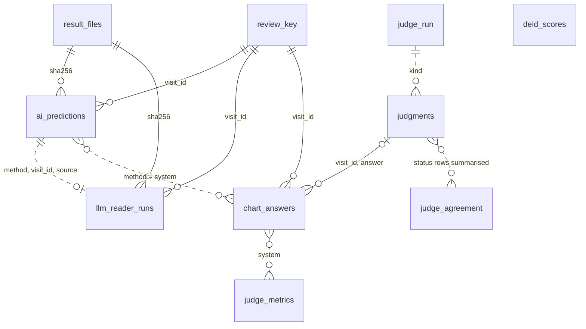
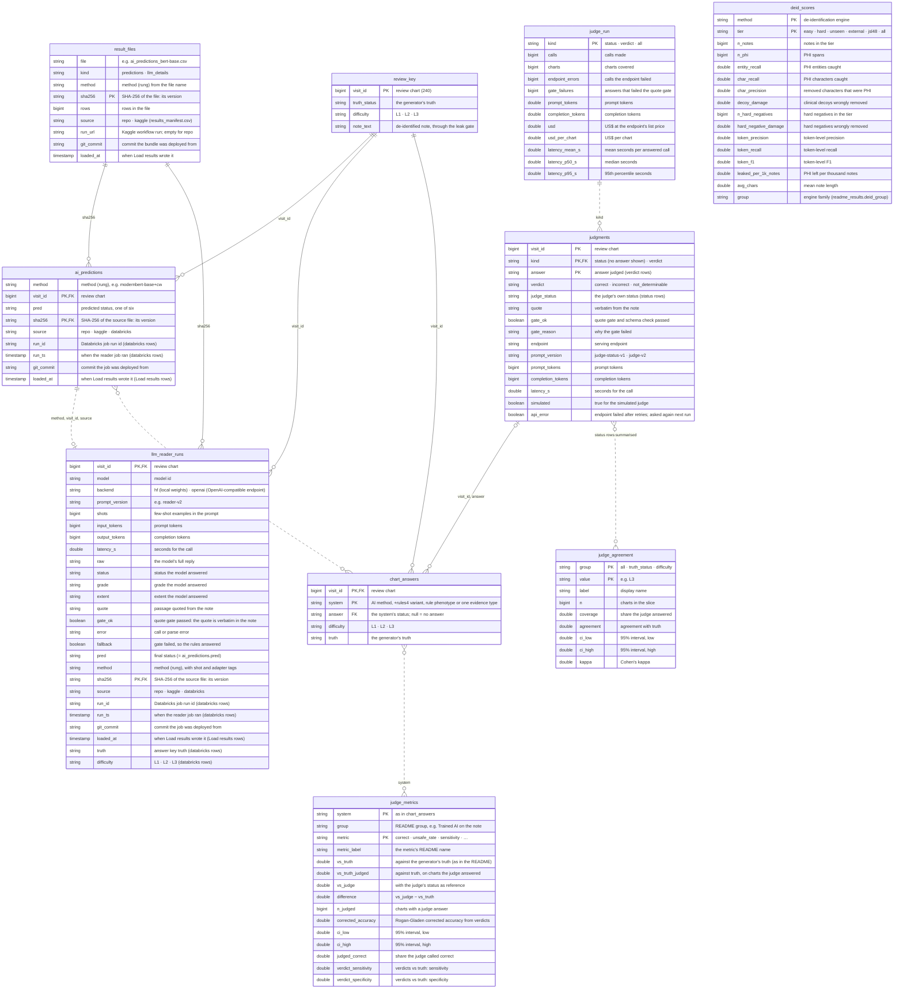

# Gold data model: `dental_omop.gold_dental_omop_perio`

Generated from [`_build/gold_model.py`](../_build/gold_model.py) by `_build/gold_erd.py`; `python/tests/test_gold_model.py` checks the columns against the CSV twins and `results_store`. Keys are logical: Delta enforces none. Solid lines are keys; dashed lines are summaries or matches, not keys. PNGs are in this folder; the draw.io and Mermaid sources are in `source/`. Who writes each table and why: [docs/gold_tables.md](../../docs/gold_tables.md). Synthetic data only.

## Tables and relationships (entity)

## Every column (full)

### `review_key`

One per synthetic review chart (answer_key/review_key.csv, not a table). Written by: 10_build_study.py (seeded).

| Key | Column | Type | Description |
|---|---|---|---|
| PK | `visit_id` | bigint | review chart (240) |
|  | `truth_status` | string | the generator's truth |
|  | `difficulty` | string | L1 · L2 · L3 |
|  | `note_text` | string | de-identified note, through the leak gate |

### `result_files`

One per committed result file version. Written by: Load results: append new versions, last.

| Key | Column | Type | Description |
|---|---|---|---|
|  | `file` | string | e.g. ai_predictions_bert-base.csv |
|  | `kind` | string | predictions · llm_details |
|  | `method` | string | method (rung) from the file name |
| PK | `sha256` | string | SHA-256 of the file: its version |
|  | `rows` | bigint | rows in the file |
|  | `source` | string | repo · kaggle (results_manifest.csv) |
|  | `run_url` | string | Kaggle workflow run; empty for repo |
|  | `git_commit` | string | commit the bundle was deployed from |
|  | `loaded_at` | timestamp | when Load results wrote it |

### `ai_predictions`

One per method and chart, per file version or reader run. Written by: Load results: delete-then-append by sha256 · MedGemma reader: replace (source, run_id, method).

| Key | Column | Type | Description |
|---|---|---|---|
|  | `method` | string | method (rung), e.g. modernbert-base+cw |
| PK,FK | `visit_id` | bigint | review chart |
|  | `pred` | string | predicted status, one of six |
| PK,FK | `sha256` | string | SHA-256 of the source file: its version |
|  | `source` | string | repo · kaggle · databricks |
|  | `run_id` | string | Databricks job run id (databricks rows) |
|  | `run_ts` | timestamp | when the reader job ran (databricks rows) |
|  | `git_commit` | string | commit the job was deployed from |
|  | `loaded_at` | timestamp | when Load results wrote it (Load results rows) |

### `llm_reader_runs`

One per LLM reader call on a chart. Written by: as ai_predictions.

| Key | Column | Type | Description |
|---|---|---|---|
| PK,FK | `visit_id` | bigint | review chart |
|  | `model` | string | model id |
|  | `backend` | string | hf (local weights) · openai (OpenAI-compatible endpoint) |
|  | `prompt_version` | string | e.g. reader-v2 |
|  | `shots` | bigint | few-shot examples in the prompt |
|  | `input_tokens` | bigint | prompt tokens |
|  | `output_tokens` | bigint | completion tokens |
|  | `latency_s` | double | seconds for the call |
|  | `raw` | string | the model's full reply |
|  | `status` | string | status the model answered |
|  | `grade` | string | grade the model answered |
|  | `extent` | string | extent the model answered |
|  | `quote` | string | passage quoted from the note |
|  | `gate_ok` | boolean | quote gate passed: the quote is verbatim in the note |
|  | `error` | string | call or parse error |
|  | `fallback` | boolean | gate failed, so the rules answered |
|  | `pred` | string | final status (= ai_predictions.pred) |
|  | `method` | string | method (rung), with shot and adapter tags |
| PK,FK | `sha256` | string | SHA-256 of the source file: its version |
|  | `source` | string | repo · kaggle · databricks |
|  | `run_id` | string | Databricks job run id (databricks rows) |
|  | `run_ts` | timestamp | when the reader job ran (databricks rows) |
|  | `git_commit` | string | commit the job was deployed from |
|  | `loaded_at` | timestamp | when Load results wrote it (Load results rows) |
|  | `truth` | string | answer key truth (databricks rows) |
|  | `difficulty` | string | L1 · L2 · L3 (databricks rows) |

### `chart_answers`

One per system and review chart (README leaderboard systems). Written by: Judge scorecard: overwrite.

| Key | Column | Type | Description |
|---|---|---|---|
| PK,FK | `visit_id` | bigint | review chart |
| PK | `system` | string | AI method, +rules4 variant, rule phenotype or one evidence type |
| FK | `answer` | string | the system's status; null = no answer |
|  | `difficulty` | string | L1 · L2 · L3 |
|  | `truth` | string | the generator's truth |

### `judgments`

One per judge call: a chart's status, or a verdict on one answer. Written by: Judge scorecard: overwrite, earlier calls kept and resumed.

| Key | Column | Type | Description |
|---|---|---|---|
| PK | `visit_id` | bigint | review chart |
| PK,FK | `kind` | string | status (no answer shown) · verdict |
| PK | `answer` | string | answer judged (verdict rows) |
|  | `verdict` | string | correct · incorrect · not_determinable |
|  | `judge_status` | string | the judge's own status (status rows) |
|  | `quote` | string | verbatim from the note |
|  | `gate_ok` | boolean | quote gate and schema check passed |
|  | `gate_reason` | string | why the gate failed |
|  | `endpoint` | string | serving endpoint |
|  | `prompt_version` | string | judge-status-v1 · judge-v2 |
|  | `prompt_tokens` | bigint | prompt tokens |
|  | `completion_tokens` | bigint | completion tokens |
|  | `latency_s` | double | seconds for the call |
|  | `simulated` | boolean | true for the simulated judge |
|  | `api_error` | boolean | endpoint failed after retries; asked again next run |

### `judge_metrics`

One per system and README metric. Written by: Judge scorecard: overwrite.

| Key | Column | Type | Description |
|---|---|---|---|
| PK | `system` | string | as in chart_answers |
|  | `group` | string | README group, e.g. Trained AI on the note |
| PK | `metric` | string | correct · unsafe_rate · sensitivity · … |
|  | `metric_label` | string | the metric's README name |
|  | `vs_truth` | double | against the generator's truth (as in the README) |
|  | `vs_truth_judged` | double | against truth, on charts the judge answered |
|  | `vs_judge` | double | with the judge's status as reference |
|  | `difference` | double | vs_judge − vs_truth |
|  | `n_judged` | bigint | charts with a judge answer |
|  | `corrected_accuracy` | double | Rogan-Gladen corrected accuracy from verdicts |
|  | `ci_low` | double | 95% interval, low |
|  | `ci_high` | double | 95% interval, high |
|  | `judged_correct` | double | share the judge called correct |
|  | `verdict_sensitivity` | double | verdicts vs truth: sensitivity |
|  | `verdict_specificity` | double | verdicts vs truth: specificity |

### `judge_agreement`

One per slice: the judge's status against the truth. Written by: Judge scorecard: overwrite.

| Key | Column | Type | Description |
|---|---|---|---|
| PK | `group` | string | all · truth_status · difficulty |
| PK | `value` | string | e.g. L3 |
|  | `label` | string | display name |
|  | `n` | bigint | charts in the slice |
|  | `coverage` | double | share the judge answered |
|  | `agreement` | double | agreement with truth |
|  | `ci_low` | double | 95% interval, low |
|  | `ci_high` | double | 95% interval, high |
|  | `kappa` | double | Cohen's kappa |

### `judge_run`

One per call type: status · verdict · all. Written by: Judge scorecard: overwrite.

| Key | Column | Type | Description |
|---|---|---|---|
| PK | `kind` | string | status · verdict · all |
|  | `calls` | bigint | calls made |
|  | `charts` | bigint | charts covered |
|  | `endpoint_errors` | bigint | calls the endpoint failed |
|  | `gate_failures` | bigint | answers that failed the quote gate |
|  | `prompt_tokens` | double | prompt tokens |
|  | `completion_tokens` | double | completion tokens |
|  | `usd` | double | US$ at the endpoint's list price |
|  | `usd_per_chart` | double | US$ per chart |
|  | `latency_mean_s` | double | mean seconds per answered call |
|  | `latency_p50_s` | double | median seconds |
|  | `latency_p95_s` | double | 95th percentile seconds |

### `deid_scores`

One per de-identification engine and test tier. Written by: Judge scorecard: overwrite, from data/deid/scores.csv.

| Key | Column | Type | Description |
|---|---|---|---|
| PK | `method` | string | de-identification engine |
| PK | `tier` | string | easy · hard · unseen · external · jsl48 · all |
|  | `n_notes` | bigint | notes in the tier |
|  | `n_phi` | bigint | PHI spans |
|  | `entity_recall` | double | PHI entities caught |
|  | `char_recall` | double | PHI characters caught |
|  | `char_precision` | double | removed characters that were PHI |
|  | `decoy_damage` | double | clinical decoys wrongly removed |
|  | `n_hard_negatives` | bigint | hard negatives in the tier |
|  | `hard_negative_damage` | double | hard negatives wrongly removed |
|  | `token_precision` | double | token-level precision |
|  | `token_recall` | double | token-level recall |
|  | `token_f1` | double | token-level F1 |
|  | `leaked_per_1k_notes` | double | PHI left per thousand notes |
|  | `avg_chars` | double | mean note length |
|  | `group` | string | engine family (readme_results.deid_group) |
