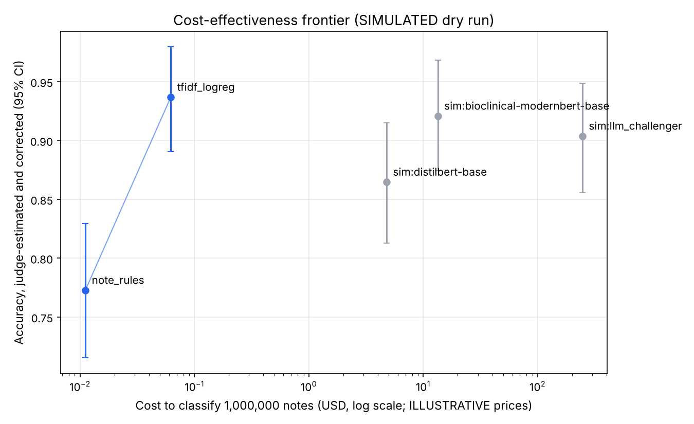
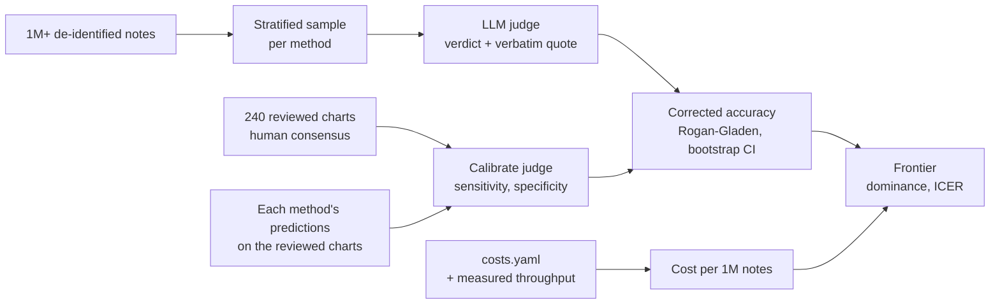

# Cost-effectiveness with an LLM judge

A real project of this kind could have a million or more notes (this exercise
assumes 1,000,000). Reviewers can stage a few
hundred charts. For everything else, the question "which method should we run
over all of them?" is answered with an LLM judge plus a cost model.



*Dry run on synthetic notes with a simulated judge, simulated reviewers,
simulated predictions for the BERT and LLM methods, and illustrative prices.
It shows what the output looks like. It is not a result.*

## How it works



1. **Choose and calibrate the judge first.** Several candidate judges grade the
   same reviewed-chart pairs; the one with the highest kappa against the
   reviewers, and not from the same model family as any LLM being evaluated,
   is selected (`judge_bakeoff.csv`; method from GlobalDentBench,
   [dentbench_methods.md](dentbench_methods.md)). On the 240 reviewed charts we know whether
   each method's prediction matched the reviewers. The judge judges the same
   pairs, which gives its sensitivity and specificity. Good models are rarely
   wrong, so the readings from single sources (exam form, procedure codes) on
   the same charts are added as calibration-only pairs to get enough wrong
   answers to measure specificity.
2. **Judge a sample, not the corpus.** Judging all million notes costs at
   least as much as using the LLM as the classifier. A stratified sample per
   method (default 400; see sample size below) is enough to rank methods.
3. **Correct for the judge's errors.** The share the judge calls correct is
   biased. The Rogan-Gladen estimator corrects it:
   `accuracy = (p_judged + specificity − 1) / (sensitivity + specificity − 1)`.
   The bootstrap resamples both the corpus sample and the calibration set, so
   the CI includes the judge's own uncertainty. If the judge is no better than
   chance (sensitivity + specificity ≤ 1), the estimate is left undefined
   rather than reported.
4. **Cost each method at full scale.** Local models are costed from measured
   throughput (notes/second on one node) × node price, plus training time.
   LLMs are costed from tokens × price. Prices live in `costs.yaml`.
5. **Compare.** Sort by cost; a method that costs more and isn't more accurate
   is dominated. Along the remaining frontier, the incremental
   cost-effectiveness ratio (ICER) is dollars per additional correctly
   classified note. Also reported: cost per 1,000 correct notes.

Every judge verdict must quote the note verbatim. Verdicts whose quote isn't in
the note fail the gate and are excluded. The gate-failure rate is reported:
a high rate means the prompt or the model needs work, and it's a finding in
itself.

## Run it

```bash
cd python
python scripts/14_benchmark_cost.py                 # corpus sample, throughput, cost per 1M notes
# real judge: any OpenAI-compatible endpoint, e.g. Databricks Model Serving
export JUDGE_BASE_URL=https://<workspace>/serving-endpoints JUDGE_API_KEY=<token> JUDGE_MODEL=<endpoint>
python scripts/15_judge.py --backend openai
python scripts/16_cost_effectiveness.py             # table + frontier chart
Rscript ../r/R/05_cost_effectiveness.R              # same table in R

# dry run with nothing external
python scripts/14_benchmark_cost.py --simulate-missing
python scripts/15_judge.py --backend simulated --simulated-review
python scripts/16_cost_effectiveness.py --simulated
```

At corpus scale on Databricks, the judge runs as batch SQL with `ai_query`:
`databricks/notebooks/02_llm_judge.sql` (same prompt, quote gate in SQL).

## Before any number is reported

- **Replace the prices.** Every price in `costs.yaml` is illustrative.
- **Measure throughput on the target hardware.** BERT-family throughput is an
  assumed planning number until it's measured on the GPU you'll use.
- **Use real note lengths.** Synthetic notes are ~80 tokens. Real dental notes
  are often several hundred, and LLM cost scales with tokens. Set
  `avg_note_tokens` from a real sample.
- **Count the fixed costs.** Compute is a small part of the total for local
  models. Labeling, reviewer time, engineering, validation and monitoring
  usually dominate. The table reports compute; the paper should report both.
- **Pin the judge.** Record the endpoint, model version and prompt version
  (`judge-v1`) with every verdict. Re-calibrate whenever any of them changes.
- **Don't let the judge grade itself.** If an LLM is also a candidate
  classifier, judge it with a different model family, or at minimum report
  that the judge and the classifier share a family.

## Sample size

For a method at about 90% accuracy, 400 judged notes give a sampling error of
about ±3 points. Calibration error adds to that. To separate two methods 2–3
points apart, plan on about 1,500 judged notes per method, plus enough wrong
predictions in calibration (aim for 200+) to pin down specificity.

## Dry-run output (simulated, illustrative prices)

| method | corrected accuracy (95% CI) | cost / 1M notes | dominated |
|--------|-----------------------------|----------------:|-----------|
| note_rules | 0.78 (0.73–0.84) | $0.01 | no |
| tfidf_logreg | 0.89 (0.84–0.94) | $0.07 | no |
| sim:distilbert-base | 0.84 (0.79–0.90) | $4.78 | yes |
| sim:bioclinical-modernbert-base | 0.90 (0.85–0.95) | $13.41 | no |
| sim:llm_challenger | 0.90 (0.86–0.95) | $257 | yes |

The shape is what to expect on real data: local models cost almost nothing to
run at this scale, so the frontier is decided by accuracy, and the LLM has to
earn its cost with clearly higher accuracy. On real notes the ranking can
change; that's what the study measures.
