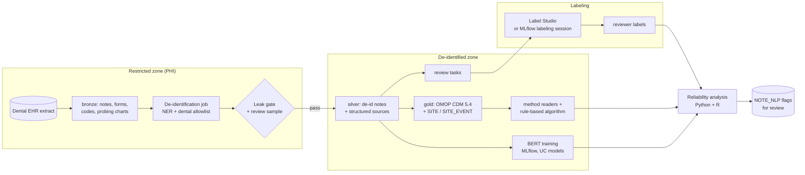

# Design review: periodontal phenotyping and NLP on Databricks

> Personal learning project; not affiliated with any organization. These are
> practice questions, not an official design review. See [DISCLAIMER](../DISCLAIMER.md).

Practice architecture-review questions for running a project like this on Databricks,
the kind to bring to a Databricks solutions architect.
The repo runs end to end on synthetic data today (local and Free Edition). This
page sets out how it would run on real, governed data, and the questions we want
an architect's view on. Context: [process.md](process.md), [plan.md](plan.md).

## What the system does

For each dental visit, seven sources (chart notes, exam forms, completed and
planned procedure codes, completed and planned procedure diagnoses, the probing
chart) each suggest a periodontal status. We compare them, derive a rule-based
phenotyping algorithm, train BERT-family models on the notes, and validate all
of it against several clinicians staging the same charts independently.

## Proposed architecture

| Layer | Plan | Repo today |
|-------|------|-----------|
| Governance | Unity Catalog: `phi_raw` catalog restricted to the de-id job's service principal; `deid` and `study` catalogs for the team; audit via system tables | n/a (synthetic) |
| De-identification | Job on CPU compute. Presidio or a Hugging Face de-id model, plus the dental allowlist; leak gate blocks promotion; a human review sample signs off each batch | `deid.py` (regex engine + Presidio hook), leak gate, recall measured on injected PHI |
| OMOP | Delta tables, CDM 5.4 plus the OHDSI Dentistry WG `SITE`/`SITE_EVENT` extension; OHDSI R tools over JDBC | `omop/ddl`, `r/R/01_etl_synthea.R` |
| Labeling | Label Studio hosted inside the boundary, or a Databricks-native labeling option (question 3) | `labelstudio/chart_review.xml`, import scripts |
| Models | Fine-tune small encoders, track in MLflow, register in UC, batch inference as a job; large models need GPU | `rungs.py`, `models.yaml`, Free Edition notebook |
| LLM challenger | `ai_query` on a Foundation Model endpoint, only after PHI handling is confirmed (question 5) | notebook cell |
| Analysis | Python and R produce identical reliability numbers | `reliability.py`, `r/R/04_reliability.R`, parity test |
| Deployment | Declarative Automation Bundles, dev/prod targets, CI from GitHub | not yet |

## Questions for an architecture review

1. **PHI isolation.** Is a separate catalog with a single service principal for
   the de-id job enough, or should raw notes sit in a separate workspace?
   What's the recommended pattern for a "promotion gate" between catalogs?
2. **De-identification on Databricks.** For clinical/dental notes, what are
   customers using: Presidio in a job, John Snow Labs Healthcare NLP from
   the Marketplace, a Hugging Face model on Model Serving, or an LLM via
   `ai_query`? Which of these is covered under a typical healthcare compliance setup for PHI?
3. **Labeling inside the boundary.** Can Label Studio run as a Databricks App
   (Django + Postgres, with Lakebase as the database)? Or is an MLflow
   labeling session / Review App with custom categorical schemas a better
   fit for "several reviewers independently stage the same 240 charts"?
4. **GPU for fine-tuning.** For a dozen encoders on a few thousand notes, is
   serverless GPU available to us, or should we plan a small classic GPU
   cluster? What does a run cost?
5. **Foundation models and PHI.** Can de-identified notes go to a
   pay-per-token Foundation Model endpoint under a typical agreement and compliance
   security profile? Can identified notes ever go, or only to a provisioned
   endpoint inside the workspace?
6. **R users.** The data science lead works in R. Best path: an R notebook on
   classic compute, `sparklyr` / Databricks Connect from Posit, or Posit
   Workbench integration? Serverless is Python and SQL only.
7. **OHDSI tools.** Anyone running ETL-Synthea, Achilles, or Atlas/WebAPI
   against Delta tables over JDBC? Any known dialect issues?
8. **Model output into OMOP.** Writing NLP flags to `NOTE_NLP` from a batch
   job: any guidance on lineage so every flag traces back to model version
   and note hash?
9. **LLM judge at scale.** We'll judge a stratified sample (~1,500 notes per
   method, ~10k calls) with `ai_query`, and need batch inference for a
   classifier rung over 1M+ notes. Provisioned throughput or pay-per-token?
   Typical throughput and cost for ~500-token notes? How do we pin the
   model version so judge calibration stays valid?
10. **Cost reporting.** Can we tag jobs and endpoints so system tables give
    us actual cost per method, to replace the planning prices in `costs.yaml`?
11. **Sequencing.** Which of the above can be decided in one working session, and which need follow-up?

## Decisions already made

- Synthetic data in a public repo until internal use is approved ([ADR 0001](adr/0001-synthetic-public-two-languages.md)).
- Model output is a flag for review in `NOTE_NLP`, never a diagnosis in `CONDITION_OCCURRENCE`.
- Reviewers stage charts independently. Consensus is majority vote; ties are reported, not broken.
- The AI model reads notes only. Reviewers see every source. That asymmetry is part of the comparison.
