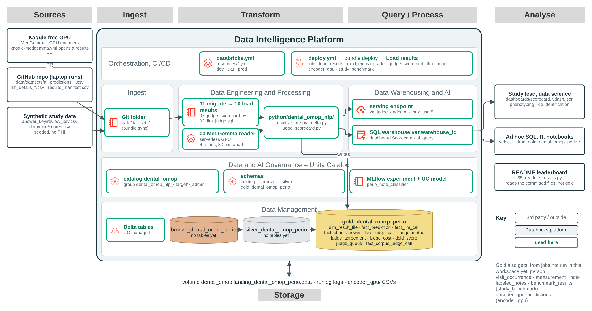

# Gold tables: `dental_omop.gold_dental_omop_perio`

> Personal learning project; synthetic data only. See [DISCLAIMER](../DISCLAIMER.md).

The gold schema holds the study's results: every model's answers on the 240 synthetic review charts, the
LLM reader's per-note details, and the judge scorecard behind the **Scorecard** AI/BI dashboard. The names
are the same in every target, because each environment is its own workspace. They follow AGENTS.md,
"SQL and data names" (spec 018): singular, `fact_` / `dim_` or a subject prefix, and a suffix on every column
that says its kind (`is_gate_ok`, `loaded_ts`, `judged_count`, `agreement_ratio`).

| Diagram | Shows |
|---|---|
| [logical architecture](../diagrams/gold/gold_logical_architecture.png) ([.drawio](../diagrams/gold/source/gold_logical_architecture.drawio)) | How results reach gold, on the Databricks reference architecture |
| [physical architecture](../diagrams/gold/gold_physical_architecture.png) ([.drawio](../diagrams/gold/source/gold_physical_architecture.drawio)) | The same, with the deployed jobs, notebooks, schemas and tables |
| [data model, entity](../diagrams/gold/gold_data_model_entity.png) ([.drawio](../diagrams/gold/source/gold_data_model_entity.drawio)) | The tables and how they relate |
| [data model, full](../diagrams/gold/gold_data_model_full.png) ([.drawio](../diagrams/gold/source/gold_data_model_full.drawio)) | Every column, type, logical key and description |

Every column is listed in [diagrams/gold/data_model.md](../diagrams/gold/data_model.md), generated with the ERDs from
[`diagrams/_build/gold_model.py`](../diagrams/_build/gold_model.py). Tests fail if the declaration, the names
the jobs write ([`gold_names.py`](../python/dental_omop_nlp/gold_names.py)) and the conventions drift apart. This
page covers who writes what, how, and what to watch.



## The tables

| Table | Was (before spec 018) | Grain (one row per) | Logical key | Written by | Write mode |
|---|---|---|---|---|---|
| `dim_result_file` | `result_files` | committed result file version | `file_sha256` | Load results (`10_load_results.py`) | append new versions, written last |
| `fact_prediction` | `ai_predictions` | method × chart × file version (or reader run) | `file_sha256, visit_id`; reader rows: `source_code, run_id, method_name, visit_id` | Load results; MedGemma reader (`03`) | delete-then-append by `file_sha256`; reader: `replace_batch` on `(source_code, run_id, method_name)` |
| `fact_llm_call` | `llm_reader_runs` | LLM reader call on one chart | as `fact_prediction` | Load results; MedGemma reader | as `fact_prediction` |
| `fact_chart_answer` | `chart_answers` | system × review chart | `visit_id, system_name` | Judge scorecard (`07`) | overwrite |
| `fact_judge_call` | `judgments` | judge call | `visit_id, call_kind_code, answer_status_code` | Judge scorecard | overwrite, keeping and resuming earlier calls |
| `judge_metric` | `judge_metrics` | system × metric | `system_name, metric_code` | Judge scorecard | overwrite |
| `judge_agreement` | (same name) | slice of the judge vs truth comparison | `slice_group_code, slice_value_code` | Judge scorecard | overwrite |
| `judge_cost` | `judge_run` | call type (`status`, `verdict`, `all`) | `call_kind_code` | Judge scorecard | overwrite |
| `deid_score` | `deid_scores` | de-identification engine × test tier | `engine_name, tier_code` | Judge scorecard (from `data/deid/scores.csv`) | overwrite |
| `judge_queue` | (same name) | prediction sampled for the corpus judge | `method_name, visit_id` | built by hand | — |
| `fact_corpus_judge_call` | `judgments`, when the corpus judge ran | corpus judge call | `method_name, visit_id` | LLM judge (`02_llm_judge.sql`, `ai_query`) | `CREATE OR REPLACE` |

Delta doesn't enforce keys. "Logical key" means the columns that identify a row, and that a rerun must not
duplicate (AGENTS.md, "Failures, retries and reruns"). `visit_id` is the shared key across all of them: a
review chart in `data/datasets/answer_key/review_key.csv`, which is a file, not a gold table.

**Names in code.** pandas frames and the committed CSVs (`data/datasets/judge/`, `llm_details_*.csv`) keep their
analysis names (`gate_ok`, `pred`), so the R parity and the README are unchanged. `gold_names.to_gold` renames a
frame as a job writes it, and fails on a column it doesn't know: a new column gets its gold name there first.

**Migration.** The Load results job's first task, `migrate_gold_names` (`11_migrate_gold_names.py`), copies each
table still under its old name to the new name with its columns renamed, once, and prints the `DROP TABLE`
statements for the old tables. It doesn't drop them: run those after checking the new tables' row counts.

Jobs that haven't run in the workspace yet write more tables to gold: `study_benchmark`
(`01_run_benchmark.py`) writes `person`, `visit_occurrence`, `measurement`, `note` (OMOP, official names),
`labeled_notes` and `benchmark_results`, and `encoder_gpu` writes `encoder_gpu_predictions`. Those three get
convention names when they're next changed; they aren't in the data model yet.

Also in the schema, though not tables: the Unity Catalog model `perio_note_classifier`
(`databricks/resources/mlops.yml`). The one function the Catalog Explorer lists isn't created by this
repo's code. The chart review agent's Unity Catalog functions are planned
(`databricks/agents/chart_review/AGENTS.md`) and will live here too.

## Results from anywhere (spec 016)

MedGemma and the GPU encoders run wherever a GPU is free (a Databricks job, Kaggle or a laptop). Every
committed result reaches these three tables. How the loading works: [results_storage.md](results_storage.md).

### `dim_result_file`

One row per version of each `ai_predictions_<method>.csv` and `llm_details_<method>.csv` under
`data/datasets/` (`simulated_*` files are never loaded). Load results writes it last, so a load that fails
partway is redone on the next run.

### `fact_prediction`

The status each method gave each review chart. Class probabilities (`p_*`) stay in the committed CSV.

A changed file is a new version, and the old version's rows stay. For one answer per method, take the
latest `file_sha256` per `(source_code, method_name)`, or one `run_id`:

```sql
with latest as (
  select file_sha256
  from dental_omop.gold_dental_omop_perio.dim_result_file
  where file_kind_code = 'predictions'
  qualify row_number() over (partition by source_code, method_name order by loaded_ts desc) = 1
)
select p.method_name, p.visit_id, p.predicted_status_code
from dental_omop.gold_dental_omop_perio.fact_prediction p
inner join latest l on l.file_sha256 = p.file_sha256;
```

### `fact_llm_call`

One row per LLM reader call: the columns of `llm_details_<method>.csv` under their gold names, plus provenance.
It matches `fact_prediction` one to one on `method_name, visit_id, source_code` (and `run_id` for `databricks`
rows). A column that is empty in a whole file takes the type the table already has.

## Judge scorecard (spec 012)


The `judge_scorecard` job writes these six tables, and the Scorecard dashboard reads them. Every metric is
computed in code (`python/dental_omop_nlp/judge_scorecard.py`), never by the LLM. Each table has a CSV
twin under `data/datasets/judge/`, under the analysis names (`simulated_*` for dry runs). Full spec:
`specs/012-judge-scorecard/data-model.md`.

### `fact_chart_answer` and `fact_judge_call`

`fact_chart_answer` holds every README system's answer on every chart. `fact_judge_call` holds one judge call per
chart (`call_kind_code = 'status'`, no answer shown) and one per distinct answer on a chart
(`call_kind_code = 'verdict'`), so one verdict serves every system that gave that answer. How the dashboard's
chart drill-down joins them:

```sql
select a.system_name, a.visit_id, a.answer_status_code, a.truth_status_code, s.judge_status_code, v.verdict_code
from dental_omop.gold_dental_omop_perio.fact_chart_answer a
left join dental_omop.gold_dental_omop_perio.fact_judge_call s
  on s.visit_id = a.visit_id and s.call_kind_code = 'status'
left join dental_omop.gold_dental_omop_perio.fact_judge_call v
  on v.visit_id = a.visit_id and v.call_kind_code = 'verdict' and v.answer_status_code = a.answer_status_code;
```

### `judge_metric`

One row per system and metric, for every README phenotyping metric. Every `_ratio` is a proportion 0 to 1
(`difference_ratio` is the difference of two).

### `judge_agreement`

The judge's own status against the truth, overall (`all`), per `truth_status` and per `difficulty`.

### `judge_cost`

Cost and speed per call type (`status`, `verdict`, `all`). With no judge run (`judge_endpoint = none`) it holds a
single `all` row with no calls.

### `deid_score`

The de-identification benchmark (`data/deid/scores.csv`) for the dashboard's de-identification page. It
doesn't join to the other tables.

## Corpus judge

`02_llm_judge.sql` judges a stratified sample (`judge_queue`) at corpus scale with `ai_query`, into
`fact_corpus_judge_call`. Before spec 018 it wrote `judgments`, with other columns than the scorecard's, so the
two jobs replaced each other's table; each now has its own.

## Cautions

- `simulated_*` files are never loaded. `fact_judge_call.is_simulated = true` marks a simulated judge's rows:
  label anything built from them as simulated wherever it's shown.
