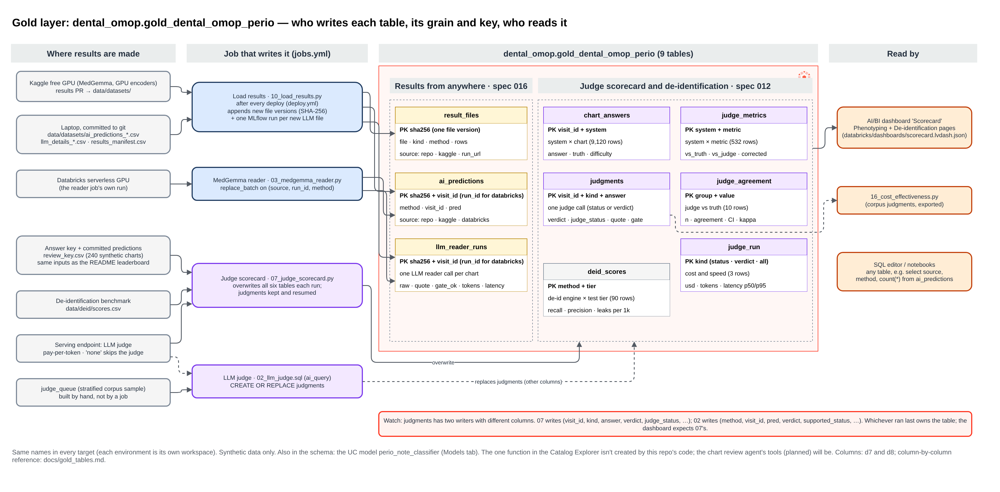
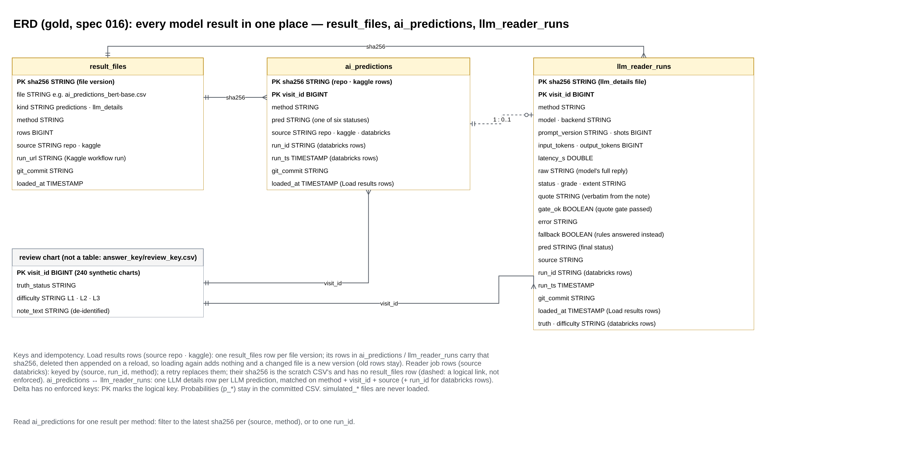
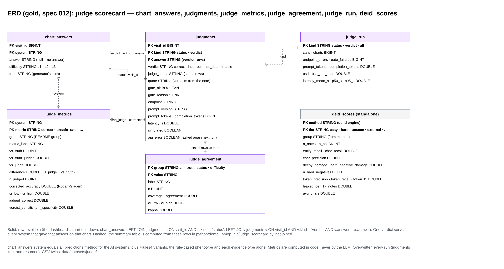

# Gold tables: `dental_omop.gold_dental_omop_perio`

> Personal learning project; synthetic data only. See [DISCLAIMER](../DISCLAIMER.md).

The gold schema holds the study's results: every model's answers on the 240 synthetic review charts, the
LLM reader's per-note details, and the judge scorecard behind the **Scorecard** AI/BI dashboard. The names
are the same in every target, because each environment is its own workspace.

| Diagram | Shows |
|---|---|
| [d6 gold overview](../diagrams/d6_gold_overview.png) ([.drawio](../diagrams/d6_gold_overview.drawio)) | Where results come from, which job writes each table, each table's grain and key, and who reads it |
| [d7 ERD: results](../diagrams/d7_erd_gold_results.png) ([.drawio](../diagrams/d7_erd_gold_results.drawio)) | `result_files`, `ai_predictions`, `llm_reader_runs`, with every column (spec 016) |
| [d8 ERD: judge scorecard](../diagrams/d8_erd_gold_judge.png) ([.drawio](../diagrams/d8_erd_gold_judge.drawio)) | `chart_answers`, `judgments`, `judge_metrics`, `judge_agreement`, `judge_run`, `deid_scores` (spec 012) |



## The nine tables

| Table | Grain (one row per) | Logical key | Written by | Write mode |
|---|---|---|---|---|
| `result_files` | committed result file version | `sha256` | Load results (`10_load_results.py`) | append new versions, written last |
| `ai_predictions` | method × chart × file version (or reader run) | `sha256, visit_id`; reader rows: `source, run_id, method, visit_id` | Load results; MedGemma reader (`03`) | delete-then-append by `sha256`; reader: `replace_batch` on `(source, run_id, method)` |
| `llm_reader_runs` | LLM reader call on one chart | as `ai_predictions` | Load results; MedGemma reader | as `ai_predictions` |
| `chart_answers` | system × review chart | `visit_id, system` | Judge scorecard (`07`) | overwrite |
| `judgments` | judge call | `visit_id, kind, answer` | Judge scorecard; LLM judge SQL (`02`, see the caution below) | `07`: overwrite, keeping and resuming earlier calls; `02`: `CREATE OR REPLACE` |
| `judge_metrics` | system × metric | `system, metric` | Judge scorecard | overwrite |
| `judge_agreement` | slice of the judge vs truth comparison | `group, value` | Judge scorecard | overwrite |
| `judge_run` | call type (`status`, `verdict`, `all`) | `kind` | Judge scorecard | overwrite |
| `deid_scores` | de-identification engine × test tier | `method, tier` | Judge scorecard (from `data/deid/scores.csv`) | overwrite |

Delta doesn't enforce keys. "Logical key" means the columns that identify a row, and that a rerun must not
duplicate (AGENTS.md, "Failures, retries and reruns"). `visit_id` is the shared key across all of them: a
review chart in `data/datasets/answer_key/review_key.csv`, which is a file, not a gold table.

Also in the schema, though not tables: the Unity Catalog model `perio_note_classifier`
(`databricks/resources/mlops.yml`). The one function the Catalog Explorer lists isn't created by this
repo's code. The chart review agent's Unity Catalog functions are planned
(`databricks/agents/chart_review/AGENTS.md`) and will live here too.

## Results from anywhere (spec 016)



MedGemma and the GPU encoders run wherever a GPU is free (a Databricks job, Kaggle or a laptop). Every
committed result reaches these three tables. How the loading works: [results_storage.md](results_storage.md).

### `result_files`

One row per version of each `ai_predictions_<method>.csv` and `llm_details_<method>.csv` under
`data/datasets/` (`simulated_*` files are never loaded). Load results writes it last, so a load that fails
partway is redone on the next run.

| Column | Type | Meaning |
|---|---|---|
| `sha256` | STRING | SHA-256 of the file: the version. **Key** |
| `file` | STRING | file name, e.g. `ai_predictions_bert-base.csv` |
| `kind` | STRING | `predictions` or `llm_details` |
| `method` | STRING | the method (rung) name from the file name |
| `rows` | BIGINT | rows in the file |
| `source` | STRING | `kaggle` (listed in `results_manifest.csv`) or `repo` |
| `run_url` | STRING | the Kaggle workflow run, empty for `repo` |
| `git_commit` | STRING | commit the bundle was deployed from |
| `loaded_at` | TIMESTAMP | when Load results wrote it |

### `ai_predictions`

The status each method gave each review chart. Class probabilities (`p_*`) stay in the committed CSV.

| Column | Type | Meaning |
|---|---|---|
| `method` | STRING | method (rung), e.g. `modernbert-base+cw`, `medgemma-1.5-4b-it` |
| `visit_id` | BIGINT | review chart. **Key** with `sha256` |
| `pred` | STRING | predicted status: `healthy`, `gingivitis`, `periodontitis_stage_1` … `_4` |
| `sha256` | STRING | version of the file the row came from (→ `result_files.sha256` for `repo` and `kaggle` rows) |
| `source` | STRING | `repo`, `kaggle` or `databricks` |
| `run_id` | STRING | Databricks job run id (`databricks` rows only) |
| `run_ts` | TIMESTAMP | when the reader job ran (`databricks` rows only) |
| `git_commit` | STRING | commit the job was deployed from |
| `loaded_at` | TIMESTAMP | when Load results wrote it (Load results rows only) |

A changed file is a new version, and the old version's rows stay. For one answer per method, take the
latest `sha256` per `(source, method)`, or one `run_id`:

```sql
select p.method, p.visit_id, p.pred
from dental_omop.gold_dental_omop_perio.ai_predictions p
join (select sha256, row_number() over (partition by source, method order by loaded_at desc) as n
      from dental_omop.gold_dental_omop_perio.result_files where kind = 'predictions') f
  on f.sha256 = p.sha256 and f.n = 1;
```

### `llm_reader_runs`

One row per LLM reader call: the columns of `llm_details_<method>.csv` plus provenance. It matches
`ai_predictions` one to one on `method, visit_id, source` (and `run_id` for `databricks` rows).

| Column | Type | Meaning |
|---|---|---|
| `visit_id` | BIGINT | review chart |
| `method` | STRING | method (rung), including shot and adapter tags |
| `model`, `backend` | STRING | model id; `hf` (local weights) or `openai` (an OpenAI-compatible endpoint) |
| `prompt_version` | STRING | e.g. `reader-v2` |
| `shots` | BIGINT | few-shot examples in the prompt |
| `input_tokens`, `output_tokens` | BIGINT | token counts |
| `latency_s` | DOUBLE | seconds for the call |
| `raw` | STRING | the model's full reply |
| `status`, `grade`, `extent` | STRING | what the model answered |
| `quote` | STRING | the passage it quoted from the note |
| `gate_ok` | BOOLEAN | the quote gate passed (the quote is verbatim in the note) |
| `error` | STRING | call or parse error, if any |
| `fallback` | BOOLEAN | the gate failed, so the rules answered instead |
| `pred` | STRING | the final status (equal to `ai_predictions.pred`) |
| `sha256`, `source`, `run_id`, `run_ts`, `git_commit`, `loaded_at` | | provenance, as in `ai_predictions` |
| `truth`, `difficulty` | STRING | answer key truth and L1/L2/L3 (`databricks` rows only) |

New columns in a file are added to the table (`mergeSchema`). A column that is empty in a whole file
takes the type the table already has.

## Judge scorecard (spec 012)



The `judge_scorecard` job writes these six tables, and the Scorecard dashboard reads them. Every metric is
computed in code (`python/dental_omop_nlp/judge_scorecard.py`), never by the LLM. Each table has a CSV
twin under `data/datasets/judge/` (`simulated_*` for dry runs). Full spec: `specs/012-judge-scorecard/data-model.md`.

### `chart_answers`

| Column | Type | Meaning |
|---|---|---|
| `visit_id` | BIGINT | review chart. **Key** with `system` |
| `system` | STRING | same systems as the README leaderboard: AI methods (= `ai_predictions.method`), their `+rules4` variants, the rule-based phenotype (`algorithm_v0`, `algorithm_design`) and each evidence type alone (`exam_form`, `probing_chart`, …) |
| `answer` | STRING | the system's status; null means no answer |
| `difficulty` | STRING | L1 / L2 / L3 |
| `truth` | STRING | the generator's truth |

### `judgments`

| Column | Type | Meaning |
|---|---|---|
| `visit_id` | BIGINT | review chart. **Key** with `kind`, `answer` |
| `kind` | STRING | `status` (the judge reads the note with no answer shown) or `verdict` (it judges one answer) |
| `answer` | STRING | the answer judged (`verdict` rows); one verdict serves every system that gave it on that chart |
| `verdict` | STRING | `correct`, `incorrect`, `not_determinable` |
| `judge_status` | STRING | the judge's own status (`status` rows) |
| `quote` | STRING | verbatim from the note |
| `gate_ok` | BOOLEAN | quote gate and schema check passed; a failed row counts as no answer |
| `gate_reason` | STRING | why the gate failed |
| `endpoint`, `prompt_version` | STRING | serving endpoint; `judge-status-v1` (status) or `judge-v2` (verdict) |
| `prompt_tokens`, `completion_tokens` | BIGINT | tokens |
| `latency_s` | DOUBLE | seconds for the call |
| `simulated` | BOOLEAN | true for the simulated judge |
| `api_error` | BOOLEAN | the endpoint failed after retries; asked again on the next run |

How the dashboard's chart drill-down joins them:

```sql
select a.system, a.visit_id, a.answer, a.truth, s.judge_status, v.verdict
from dental_omop.gold_dental_omop_perio.chart_answers a
left join dental_omop.gold_dental_omop_perio.judgments s on s.visit_id = a.visit_id and s.kind = 'status'
left join dental_omop.gold_dental_omop_perio.judgments v on v.visit_id = a.visit_id and v.kind = 'verdict' and v.answer = a.answer;
```

### `judge_metrics`

One row per system and metric, for every README phenotyping metric.

| Column | Type | Meaning |
|---|---|---|
| `system` | STRING | as in `chart_answers`. **Key** with `metric` |
| `group` | STRING | README group, e.g. *Trained AI on the note* |
| `metric`, `metric_label` | STRING | `correct`, `incorrectly_assigned`, `unsafe_rate`, `sensitivity`, …, and its README name |
| `vs_truth` | DOUBLE | against the generator's truth (as in the README) |
| `vs_truth_judged` | DOUBLE | against truth, on the charts the judge answered |
| `vs_judge` | DOUBLE | the same metric with the judge's status as reference |
| `difference` | DOUBLE | `vs_judge − vs_truth` |
| `n_judged` | BIGINT | charts with a judge answer |
| `corrected_accuracy`, `ci_low`, `ci_high` | DOUBLE | Rogan-Gladen corrected accuracy from the verdicts, 95% interval (`correct` rows) |
| `judged_correct` | DOUBLE | share the judge called correct |
| `verdict_sensitivity`, `verdict_specificity` | DOUBLE | how well the verdicts match the truth |

### `judge_agreement`

The judge's own status against the truth, overall (`all`), per `truth_status` and per `difficulty`.

| Column | Type | Meaning |
|---|---|---|
| `group`, `value` | STRING | slice, e.g. `difficulty` / `L3`. **Key** |
| `label` | STRING | display name |
| `n` | BIGINT | charts in the slice |
| `coverage` | DOUBLE | share the judge answered |
| `agreement`, `ci_low`, `ci_high` | DOUBLE | agreement with truth and 95% interval |
| `kappa` | DOUBLE | Cohen's kappa |

### `judge_run`

Cost and speed per call type: `kind` (`status`, `verdict`, `all`; **key**), `calls`, `charts`,
`endpoint_errors`, `gate_failures` (BIGINT), `prompt_tokens`, `completion_tokens`, `usd`, `usd_per_chart`,
`latency_mean_s`, `latency_p50_s`, `latency_p95_s` (DOUBLE). With no judge run (`judge_endpoint = none`) it holds a single `all` row with no calls.

### `deid_scores`

The de-identification benchmark (`data/deid/scores.csv`) for the dashboard's de-identification page. It
doesn't join to the other tables.

| Column | Type | Meaning |
|---|---|---|
| `method`, `tier` | STRING | de-id engine and test tier (`easy`, `hard`, `unseen`, `external`, `jsl48`, `all`). **Key** |
| `group` | STRING | engine family, from `readme_results.deid_group` |
| `n_notes`, `n_phi`, `n_hard_negatives` | BIGINT | notes, PHI spans and hard negatives in the tier |
| `entity_recall`, `char_recall`, `char_precision` | DOUBLE | PHI caught, by entity and by character |
| `decoy_damage`, `hard_negative_damage` | DOUBLE | clinical text wrongly removed |
| `token_precision`, `token_recall`, `token_f1` | DOUBLE | token-level scores |
| `leaked_per_1k_notes` | DOUBLE | PHI left per thousand notes |
| `avg_chars` | DOUBLE | mean note length |

## Cautions

- **`judgments` has two writers with different columns.** `07_judge_scorecard.py` writes the columns above.
  `02_llm_judge.sql` (the `llm_judge` job, corpus scale with `ai_query`) runs `CREATE OR REPLACE` with
  `method, visit_id, pred, verdict, supported_status, quote, rationale, gate_ok, error, prompt_version,
  judge_model`. Whichever ran last owns the table, and the dashboard and the scorecard's resume step expect
  `07`'s. Run the corpus judge into another table name until that's settled.
- `simulated_*` files are never loaded. `judgments.simulated = true` marks a simulated judge's rows: label
  anything built from them as simulated wherever it's shown.
