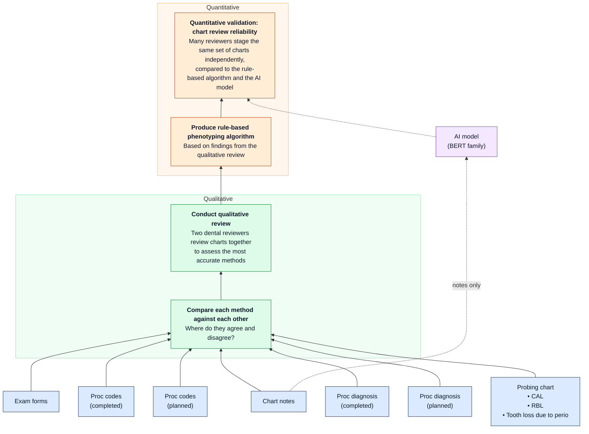

# Study process

How periodontal status is phenotyped from a dental EHR, and how each step maps
to this repo. The diagram is the study design; the table under it says where
each box lives.

## Where each step lives

| Step | Repo | Output |
|------|------|--------|
| Seven sources per visit | `python/dental_omop_nlp/study.py` (generate), `sources.py` (codes, forms), `clinical_notes.py` (notes), `labels.py` (probing chart) | `data/datasets/answer_key/review_key.csv` |
| Read each source | `note_reader.py` (notes), `sources.READERS` (forms, codes, diagnoses), chart staging rules in `labels.py` | one status per source per visit |
| Compare each method against each other | `phenotype.agreement_matrix`, `phenotype.coverage` | `data/datasets/method_agreement.csv`, `method_coverage.csv` |
| Qualitative review | People. Reviewers work from `method_agreement.csv` and the disagreeing charts; their findings go into `docs/labeling_protocol.md` and `RULES_V0` | rules, written down |
| Rule-based phenotyping algorithm | `phenotype.phenotype_v0` + `RULES_V0` (placeholder hierarchy until the review sets it) | `algorithm_v0` column |
| AI model | `rungs.py` + `models.yaml`; `scripts/11_ai_predict.py` trains on `train.csv`, predicts the review charts | `ai_predictions_<model>.csv` |
| Many reviewers stage the same charts | Label Studio: `labelstudio/chart_review.xml`, tasks in `data/datasets/review_tasks.json` | Label Studio JSON export(s) |
| Reliability: reviewers vs algorithm vs AI | `scripts/12_import_review.py`, `scripts/13_reliability.py` (Python) and `r/R/04_reliability.R` (R), parity-tested | Fleiss' kappa, consensus, each method vs reviewers |

## What's real and what's simulated today

Everything runs end to end on synthetic data. Two pieces are stand-ins:

- **The qualitative review** has not happened, so `RULES_V0` is a placeholder
  hierarchy (probing chart → note diagnosis → diagnosis codes → form → procedures).
- **The reviewers** are simulated (`12_import_review.py --simulate 4`) so the
  import and reliability code can be tested. Every simulated file is named
  `simulated_*` and every printout says so. They are not results.

## Real-data path (once approved)

Same code, different inputs. The EHR extract replaces `generate_visits`; the
de-identification gate runs inside the secure environment; only notes that pass
it are loaded into a Label Studio instance hosted inside that environment.
Real PHI never goes into Label Studio, this repo, or a model.
